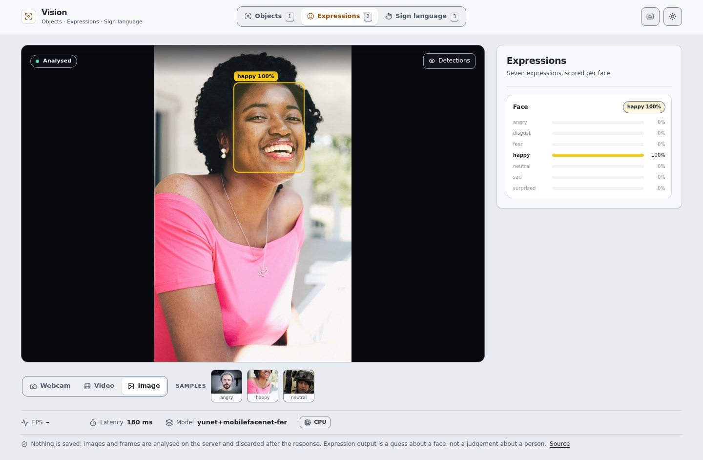
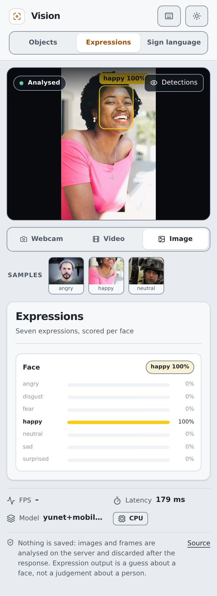
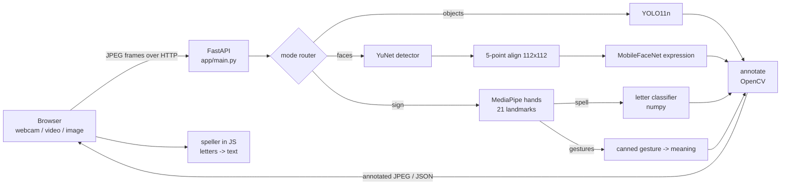

# AI Vision Detection
Real-time **object detection**, **facial expression recognition** and **ASL fingerspelling / gesture recognition** in the browser: live webcam, video file or image, CPU only, served by FastAPI.

[](https://github.com/dhia-rek/ai-vision-detection/actions/workflows/ci.yml)


*Object-detection montage on the five bundled samples (illustrative; benchmark figures below).*

| Objects | Facial expression |
| --- | --- |
|  |  |
| *Street scene: boxes drawn client-side, counts per class on the right.* | *Happy, with the score of all seven expressions.* |

| Sign: gestures | Sign: letters |
| --- | --- |
|  |  |
| *"I love you", 90 %.* | *Letter Y, 100 %, hand skeleton overlay.* |


*A sample video being fingerspelled live: current letter, hold-progress ring and the word so far.*

| Light theme | Phone (dark) | Phone (light) |
| --- | --- | --- |
|  |  |  |

## Modes

| Mode | What it does | Models |
| --- | --- | --- |
| **Objects** | Boxes + labels for the 80 COCO classes | YOLO11n |
| **Facial expression** | Finds faces, reads one of 7 expressions per face | YuNet + MobileFaceNet |
| **Sign language** | Fingerspelling (ASL letters A-Z), Gestures (7 hand shapes), and local Record mode (landmarks only) | MediaPipe hands + our letter classifier |

Sources: **Webcam**, **Video file**, **Image**. Bundled sample images and sample videos need no camera.
Deep links: `/?mode=objects|faces|sign&sign_mode=spell|gestures|record&source=webcam|video|image&sample=<file>`.

This was built as a demo of how a browser can help communicate with non-speaking people. It is **not** a replacement for an interpreter (see [Limitations](#limitations)).

## Web UI

One viewport, one insight panel. The browser sends frames to `/api/analyze?annotate=false` and draws the result itself: boxes, labels and hand skeletons are painted on a `<canvas>` over the media from the returned JSON, so they stay sharp at any size and glide between frames. Per-class colours come from a fixed palette.

- **Modes** (keys `1` `2` `3`): Objects (counts per class as bars), Expressions (all seven scores per face), Sign language (current letter, hold-progress ring, word builder; Letters, Gestures, or Record). Letter predictions are temporally smoothed and confidence-gated to reduce flicker. Record mode stores only hand landmarks locally for later training; see [recording instructions](docs/recording.md).
- **Sources:** webcam, video file or image; drop a file anywhere on the page; bundled samples are one click away. `Space` pauses, `O` toggles the overlay, `T` the theme, `?` lists shortcuts.
- **Status bar:** live FPS with a sparkline, round-trip latency, model name, device.
- Dark by default, follows `prefers-color-scheme`, with a manual toggle. Responsive down to a phone. Plain HTML, CSS and JS in `backend/static/`, no build step and no external requests. Icons are inline [Lucide](https://lucide.dev) (ISC).
- Screenshots: `uv run --no-project --with playwright python scripts/ui_shots.py --base http://localhost:8000 --out shots` (all modes, desktop and phone, dark and light; fails on console errors or horizontal overflow).

## Architecture



Images and frames are decoded in memory and never saved by the app (the web framework may spool uploads over 1 MiB to a temporary file for the duration of the request; videos are always written to a private temp file that is deleted right after). Detectors are created lazily per mode and guarded by a lock.

## How each mode works

**Objects.** Letterbox resize, one YOLO11 forward pass, confidence threshold (`AVD_CONF`, default 0.25), NMS, COCO labels, drawn with OpenCV. No training or fine-tuning here.

**Facial expression.** (`faces.py`)
1. **YuNet** (OpenCV `FaceDetectorYN`) finds faces and 5 landmarks (eyes, nose, mouth corners). Faces smaller than 24 px are skipped.
2. The face is **aligned** to 112x112 with a similarity transform onto reference landmark positions.
3. **MobileFaceNet** (OpenCV DNN, no torch) outputs a softmax over 7 classes: angry, disgust, fear, happy, neutral, sad, surprised. The top class and a top-3 are returned.

**Sign language.** (`sign.py`) One MediaPipe Gesture Recognizer pass gives 21 landmarks per hand (up to 2 hands) plus a canned gesture.
- **Fingerspelling:** landmarks become 287 scale- and rotation-normalised geometric features (`sign_features.py`) for a small MLP (`asl_classifier.py`, pure NumPy, 412 KB). It was trained with mirrored hands and pose augmentation on three openly licensed collections (MIT and CC BY 4.0; [sources and licences](docs/asl-datasets.md)). Inference uses landmarks, not stored images. The same checkpoint has a [browser JSON export](backend/app/models/asl_letters_web.json) with a [format contract](scripts/README.md) for the separate browser-inference UI branch.
- **Gestures:** MediaPipe's canned gestures are mapped to a meaning: thumbs up -> yes, thumbs down -> no, open palm -> hello / stop, I love you, victory / peace, pointing up -> wait, closed fist.
- **Speller (browser, same rules as `WordBuilder` in `sign.py`):** hold a letter **0.8 s** to commit it (confidence >= 0.6); change shape or drop the hand to repeat a letter; **1.5 s** without a hand adds a space. **Space / Backspace / Clear** buttons are in the UI.

> This recognises the ASL fingerspelling alphabet and a few hand gestures from **static hand shapes**. It is **not** sign-language translation: ASL is a full language with motion, facial grammar and two-handed signs, none of which this models. "Thank you" and the real ASL signs for yes / no / hello involve motion and are not supported.

## Model quality

| Mode | Before | After | Evaluation set and notes |
| --- | --- | --- | --- |
| **ASL letters** | v1: 47.3% on Roboflow 100 `sign-language-sokdr` (held-out collection); its random within-dataset split was 96.5% | v3 MLP: **76.0%** (672 detected hands; 95% CI 72.7–79.1); 76.8% static letters excluding J/Z. At confidence ≥0.6: 84.2% accuracy on 83% coverage. | Roboflow 100 `sign-language-sokdr`, full-resolution originals from EitanG98/asl_letters; held out from v3 training/current selection, but an earlier project iteration used it to compare recipes. No signer IDs are published: signer overlap is unverified, so signer-independence is not established. Per-letter scores/confusion matrix: [ASL evaluation](docs/asl-eval.md). Sources/licences: [ASL datasets](docs/asl-datasets.md). Target ≥80% was **not reached**. |
| **Objects** | YOLOv8n: mAP@0.5 **0.6290**, median CPU 63.0 ms (**15.88 fps**) | YOLO11n: mAP@0.5 **0.6263**, median CPU 54.1 ms (**18.49 fps**); mAP@0.5:0.95 0.4713 (vs 0.4658). YOLO11s: 0.7229 mAP@0.5 but 2.10 fps, not selected. | First 100 annotated COCO val2017 image IDs in a generated YOLO-format subset proxy (not official COCO mAP). CPU timing on five bundled object photos. |
| **Expressions** | Existing YuNet + MobileFaceNet; no comparable benchmark previously reported | **25.00%** (175/700; 25.33% among detected faces) | [GFFD-2025 v1](https://data.mendeley.com/datasets/wmfd4p3z32/1) raw archive, CC BY 4.0, balanced deterministic sample (100/class), seven expressions; 9 no-face misses. Class accuracy (all images, misses count wrong): |

| Emotion | Accuracy |
| --- | ---: |
| Angry | 0% |
| Disgust | 1% |
| Fear | 0% |
| Happy | 91% |
| Neutral | 51% |
| Sad | 19% |
| Surprised | 13% |

GFFD-2025 has subject overlap and some questionable labels, so this external-dataset check is not a generalization estimate. Citation: Diya, Ferdos & Rahman (2025), *Genuine and Fake Facial Emotion Dataset*, Mendeley Data, [doi:10.17632/wmfd4p3z32.1](https://doi.org/10.17632/wmfd4p3z32.1). The expression model was not changed: this test does not establish that another open model is better. YOLO11n is distributed under AGPL-3.0. ASL citations, attribution and rejected candidates are in [ASL datasets](docs/asl-datasets.md).

## Results

Measured with the real models on the bundled samples. These are qualitative checks, not benchmarks.

**Objects** (YOLO11n)

| Image | Detections |
| --- | --- |
| `bicycles.jpg` | 10x bicycle |
| `cats.jpg` | 2x cat, 1x chair |
| `dog.jpg` | 1x dog (0.95) |
| `livingroom.jpg` | 3x chair, 2x couch, 1x tv, 1x suitcase |
| `street.jpg` | 6x car, 2x truck, 1x person, 1x traffic light |

**Facial expression**

| Image | Result |
| --- | --- |
| `happy.jpg` | happy 1.00 |
| `angry.jpg` | angry 0.91 |
| `neutral.jpg` | neutral 1.00 |

Known failures: a CC BY photo of a surprised young woman with open mouth read as *happy* 0.59 (surprised was not top 1). The angry photo downscaled from 960 to 640 px wide flips to *neutral* 0.59 (angry 0.33): borderline expressions are resolution-sensitive. In the 640 px `faces.mp4` demo the angry segment is read as neutral. Drawings and line-art faces are not detected.

**Sign gestures:** "I love you" 0.82 / 0.90 on two photos; thumbs up 0.56-0.69 on three photos. Open palm, victory and thumbs-down photos taken from a distance (small hands) were **not detected at all**: MediaPipe needs the hand reasonably large in frame (webcam distance).

**Sign letters:** see the held-out collection results, per-letter accuracy and confusion matrix in [Model quality](#model-quality) and [docs/asl-eval.md](docs/asl-eval.md). J and Z are motion letters and remain limited when classified from one pose.

**Video:** `fingerspelling_cab.mp4` (built from three letter photos) -> `/api/video` text **"CAB"** in the current real-model test. An earlier browser run also produced "CAB" live; its FPS is historical, not a benchmark for the new classifier.

The sample videos are **slideshows built from openly licensed still photos**, not real recordings.

Reproduce the image results:

```bash
cd backend
uv run python -m app.demo --mode objects --out ../docs/demo   # or faces / sign
```

## Performance

Measured on this project's 6-vCPU VPS, CPU only. The non-object rows are earlier 640×480 localhost
live-mode measurements (40 frames after warm-up); the object row is the new five-photo benchmark:

| Mode | Server inference (median) | Round trip (median) | Throughput |
| --- | --- | --- | --- |
| Objects (YOLO11n, five-photo benchmark) | 54.1 ms | not measured | **18.49 fps** |
| Facial expression | 36 ms | 42 ms | **24 fps** |
| Sign: gestures | 37 ms | 43 ms | **23 fps** |
| Sign: fingerspelling | 37 ms | 43 ms | **23 fps** |

The earlier browser video test ran at **8–12.6 fps**, but predates the YOLO11n and ASL changes;
it is not a current end-to-end benchmark. Over a real network expect less. The UI sends one frame
at a time and never queues; throughput varies with CPU load.

## Project structure

```text
backend/app/
  main.py           FastAPI app: routes, upload limits, mode routing, video analysis
  detector.py       Detection dataclass, Detector protocol, YOLO + stub detectors, drawing, JPEG helpers
  faces.py          YuNet face detector + MobileFaceNet expression classifier
  sign.py           MediaPipe hands -> ASL letters or gestures; WordBuilder for fingerspelling
  sign_features.py  Normalized 287-feature representation shared by training and inference
  asl_classifier.py Pure-numpy ASL letter classifier (loads models/asl_letters.npz)
  zoo.py            Model registry: checksummed downloads and the local cache
  demo.py           CLI that runs a mode over the bundled samples
backend/static/     Web UI: index.html, app.css, app.js (vanilla JS, no build step, canvas overlay)
scripts/train_asl.py  Trains the ASL letter classifier
tests/              pytest suite (stub detector by default; `slow` marker runs real models)
```

## Development

```bash
uv sync                         # install runtime + dev dependencies
uv run pytest -q -m "not slow"  # fast tests (drop the marker to run real models)
uv run ruff check .             # lint, including Google-style docstring rules
uv run ruff format --check .    # formatting
uv run mypy                     # type check (basic mode)
uv run interrogate              # docstring coverage, fails under 90%
```

CI runs the same checks on every pull request.

## Quick start

```bash
# 1. Install (uv; CPU-only torch is used on Linux)
uv sync

# 2. (optional) pre-download the models; otherwise they download on first use
cd backend && uv run python -m app.zoo

# 3. Run the app
uv run uvicorn app.main:app --reload
# open http://localhost:8000

# Tests (from the repo root)
uv run pytest -q
```

Models are cached in `~/.cache/ai-vision-detection/models` (or `AVD_MODEL_DIR`) and **verified by SHA-256**. Nothing is committed except the tiny ASL classifier.

Docker (also targets a Hugging Face Space, see `DEPLOY.md`):

```bash
docker build -t ai-vision-detection .
docker run -p 7860:7860 ai-vision-detection
```

The image installs `libegl1`, `libgles2` and `libgl1` (needed by MediaPipe) and pre-downloads the models at build time. Webcam access needs `localhost` or HTTPS (a browser requirement).

CLI demo: `uv run python -m app.demo --mode objects|faces|sign` (stub mode: `AVD_DETECTOR=stub`).

## API

| Method | Path | Description |
| --- | --- | --- |
| GET | `/` | Web UI |
| GET | `/health` | Liveness check |
| GET | `/api/modes` | Modes and the model registry (size, licence, source) |
| POST | `/api/analyze?mode=objects\|faces\|sign&sign_mode=spell\|gestures&annotate=true\|false` | Multipart `file`: image in, JSON out: `detections` (class, confidence, bbox in pixels of the analysed image; `points` for hands; `top3`, `scores` (all 7 expressions), `handedness`, `gesture` where relevant), `image_size`, `model_used`, `device`, `inference_ms`, and `result_image` (annotated JPEG data URL) unless `annotate=false`. The web UI uses `annotate=false` and draws the boxes itself |
| POST | `/api/frame` | Multipart `frame` (+ `mode`, `sign_mode`, `quality` 10-95): annotated JPEG; headers `X-Detections` (top 25 by confidence; `X-Detections-Truncated`), `X-Total-Detections`, `X-Inference-Ms` |
| POST | `/api/video?mode=&sign_mode=&fps=5&max_seconds=60` | Multipart `file` (video; `fps` <= 10, `max_seconds` <= 120, at most 600 frames analysed): per-frame detections (class, confidence, bbox), `label_counts`, `avg_inference_ms`, and `text` in fingerspelling mode |
| POST | `/detect/`, `/detect/frame` | Legacy object-detection endpoints |
| GET | `/demo/samples` | Bundled samples per group |
| GET | `/demo/samples/{group}/{name}` | Fetch a sample |
| POST | `/demo/analyze/{group}/{name}` | Run a mode on a bundled sample image |

Errors: `400` not an image / video or undecodable, `413` too large, `404` unknown sample. Interactive docs at `/docs`.

## Configuration

| Variable | Default | Description |
| --- | --- | --- |
| `AVD_DETECTOR` | `real` | `real` for the models, `stub` for a fake detector (tests, no models needed) |
| `AVD_WEIGHTS` | downloaded `yolo11n.pt` | Path to YOLO weights for Objects mode |
| `AVD_MODEL_DIR` | `~/.cache/ai-vision-detection/models` | Model cache directory |
| `AVD_CONF` | `0.25` | Object confidence threshold |
| `AVD_MAX_UPLOAD_MB` | `10` | Maximum image upload size |
| `AVD_MAX_VIDEO_MB` | `50` | Maximum video upload size |
| `AVD_MAX_PIXELS` | `40` | Maximum decoded image size in megapixels (decompression-bomb guard) |
| `AVD_CORS_ORIGINS` | *(empty)* | Comma-separated allowed origins; CORS is off unless set |

## Models & licences

| Model | Size | Licence | Source / use |
| --- | --- | --- | --- |
| `yolo11n.pt` | 5.4 MB | **AGPL-3.0** | Ultralytics YOLO11n, COCO 80 classes (objects) |
| YuNet face detector | 0.2 MB | MIT | OpenCV Zoo (faces) |
| MobileFaceNet expression | 4.6 MB | Apache-2.0 | OpenCV Zoo, trained on RAF-DB (faces). RAF-DB is a research dataset with its own non-commercial terms; the weights are Apache-2.0 |
| `gesture_recognizer.task` | 8.0 MB | Apache-2.0 | Google MediaPipe: hand landmarks + 7 canned gestures |
| `asl_letters.npz` | 412 KB | MIT (ours) | 287-feature NumPy MLP, trained from landmark data under MIT and CC BY 4.0; sources and citations in [docs/asl-datasets.md](docs/asl-datasets.md) |

ASL evaluation uses the Roboflow 100 `sign-language-sokdr` collection (CC BY 4.0; EitanG98 mirror) and Cabana 2025 (CC BY 4.0); details and citations are in [docs/asl-datasets.md](docs/asl-datasets.md). Test photos in `tests/fixtures` and samples in `backend/samples` are openly licensed; see `tests/fixtures/*/README.md` and [backend/samples/CREDITS.md](backend/samples/CREDITS.md).

## Project structure

```
backend/
  app/
    main.py            FastAPI app factory, routes, mode router, video analysis
    detector.py        YoloDetector, StubDetector, annotate, JPEG helpers
    faces.py           YuNet + MobileFaceNet expression detector
    sign.py            MediaPipe hands, gesture map, WordBuilder
    sign_features.py   Landmark -> normalized 287 features
    asl_classifier.py  Pure-NumPy MLP letter classifier
    zoo.py             Model registry: URLs, SHA-256, download + cache
    demo.py            Offline demo CLI (--mode objects|faces|sign)
    models/asl_letters.npz   The only committed model (412 KB)
  samples/             Openly licensed images + 2 slideshow videos + CREDITS.md
  static/               Web UI: index.html (markup + inline SVG icons), app.css, app.js
scripts/train_asl.py   Train + export the ASL letter classifier
scripts/export_asl_web.py  Export the trained MLP to browser-readable JSON
tests/                 pytest suite and photo fixtures
docs/                  Demo GIF and screenshots
Dockerfile, DEPLOY.md  Container and Hugging Face Space deployment
```

## Engineering notes

- **Tooling**: `uv` + `pyproject.toml` + lockfile, CPU-only PyTorch on Linux, ruff.
- **Model zoo**: models are downloaded on demand and SHA-256 verified (atomic temp-file rename), so the repo stays small.
- **Design**: one `Detector` interface per mode behind an app factory; a torch-free `StubDetector` lets tests run in seconds without models. Face models run on OpenCV DNN, no extra framework.
- **Small classifier, small risk**: the ASL classifier is plain numpy (no sklearn at runtime) and has a feature-version check.
- **Security & privacy**: uploads decoded in memory; size and pixel limits; CORS off by default; internal errors not echoed; client filenames never used as paths.
- **Tests and CI**: pytest (API, detectors, WordBuilder, real-model checks) and GitHub Actions.
- **Deployment**: Dockerfile and Hugging Face Space preparation (`DEPLOY.md`).

## Large files

The repo history carries about 59 MB of old YOLO weights (`yolov8m.pt` 52 MB, `yolov8n.pt` 6.5 MB, committed several times). The code fetches YOLO11n by default via `app.zoo`; `AVD_WEIGHTS` can still point at alternate weights. History was not rewritten.

## Limitations

**All modes**
- CPU latency plus JPEG/network round trips limit the webcam frame rate. No tracking: each frame is independent, so results can flicker.
- Quality was only checked qualitatively on a few images per mode.

**Objects**
- 80 COCO classes only. Small or occluded objects are missed; false positives happen in unusual light or viewpoints.

**Facial expression**
- Reads **expressions, not emotions**. Seven coarse classes; blended or subtle expressions are poorly covered.
- Borderline cases are fragile and resolution-sensitive (see Results). Surprise and angry were misread in our tests.
- Training data (RAF-DB) is mostly web and posed images; accuracy across ages, skin tones, cultures, lighting and head poses is uneven and not measured here.
- Line art and drawn faces are not detected; very small faces (<24 px) are skipped.

**Sign language**
- Static hand shapes only: no motion, no facial grammar, no two-handed signs. It is not translation.
- Letters J and Z need motion; here they come from a single pose and are unreliable. Similar shapes (e.g. H/U, I/J, S/T/A/N) get confused.
- Collection-independent ASL accuracy remains below the 80% target (76.0% on the held-out Roboflow 100 collection; signer overlap unverified); see [Model quality](#model-quality) and [the per-letter report](docs/asl-eval.md).
- MediaPipe needs the hand reasonably large in frame; hands far from the camera are not detected. Gestures are MediaPipe's canned set only.
- The speller commits a letter only after a steady 0.8 s hold.

## Ethics & privacy

- **Privacy:** images and webcam frames are processed in memory and never stored. Video uploads to `/api/video` are written to a private temp file only for decoding and deleted when the request ends. There are no face embeddings, no identification or matching of people, and no logging of images.
- **Expression is not emotion.** The face model maps facial-muscle configuration to a label. It does not know how anyone feels, and a smile can be polite, ironic or masked. Treat output as a rough description of a picture, never as a fact about a person.
- **Bias.** The model was trained on a limited, mostly posed / web dataset and is likely to perform unevenly across demographic groups and cultures. Errors are not evenly distributed.
- **Do not use it** for hiring, education or exam proctoring, policing, border control, insurance, or any decision about a person. The EU AI Act prohibits emotion recognition in workplaces and education (with medical and safety exceptions); this is context, not legal advice, so check the rules where you are.
- **Consent.** Only run it on yourself or on people who know and agree. Do not run it covertly on others, and do not point it at images of people you have no right to process (e.g. under GDPR).
- Sign mode is an accessibility demo. It must not be relied on to understand a deaf or non-speaking person; use a qualified interpreter or ask the person.
- Detection output is not evidence of anything.

## License

- **Code**: MIT, see [LICENSE](LICENSE).
- **Ultralytics / YOLO11 weights** are **AGPL-3.0**. Distributing this app or serving it over a network brings AGPL obligations (including offering source). Ultralytics sells an enterprise licence for proprietary use.
- Other models: see the table above (MIT / Apache-2.0). Mind the RAF-DB note.
- **Samples and fixtures**: CC0, public domain, Unlicense or CC licences as listed in [backend/samples/CREDITS.md](backend/samples/CREDITS.md) and `tests/fixtures/*/README.md`; follow attribution where required.

## Stack

Python 3.11+, FastAPI, Uvicorn, Ultralytics YOLO11, PyTorch (CPU), MediaPipe, OpenCV (headless, DNN), NumPy, Pillow, vanilla HTML/JS front-end; uv, pytest, ruff, GitHub Actions, Docker.

## Acknowledgements

- [Ultralytics YOLO11](https://github.com/ultralytics/ultralytics) and the [COCO dataset](https://cocodataset.org).
- [OpenCV Zoo](https://github.com/opencv/opencv_zoo) (YuNet, MobileFaceNet) and the RAF-DB authors.
- [Google MediaPipe](https://github.com/google-ai-edge/mediapipe).
- Datasets: [sid220/asl-now-fingerspelling](https://huggingface.co/datasets/sid220/asl-now-fingerspelling) (training), [EitanG98/asl_letters](https://huggingface.co/datasets/EitanG98/asl_letters) (evaluation).
- Sample images: Wikimedia Commons and the sources in `backend/samples/CREDITS.md`.

Author: Dhia ([@dhia-rek](https://github.com/dhia-rek)).
