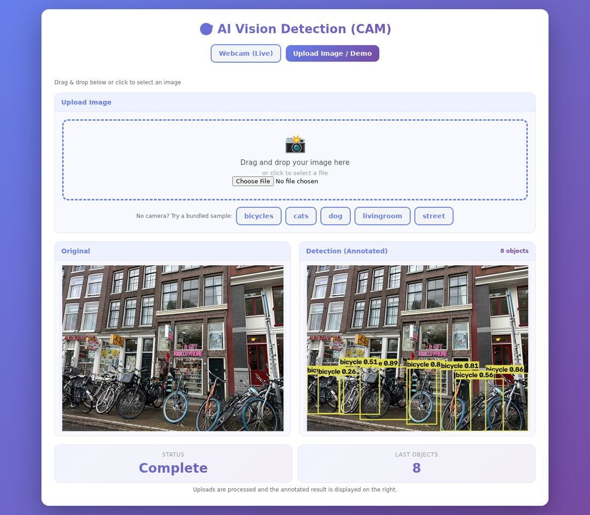
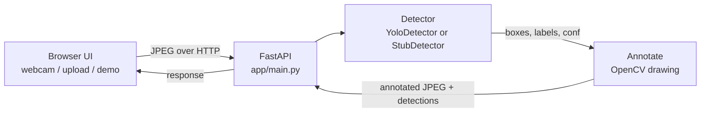

# AI Vision Detection
Real-time object detection in the browser: live webcam, image upload, or an offline demo, powered by a FastAPI backend and a pretrained YOLOv8n.

[](https://github.com/dhia-rek/ai-vision-detection/actions/workflows/ci.yml)


*Offline demo mode on the five bundled sample images (YOLOv8n, CPU).*

> **Original author: [Akram Khattabi](https://github.com/AkramKhattabi) ([@AkramKhattabi](https://github.com/AkramKhattabi)).**
> The project, its idea, the detection UI and the webcam/upload workflow are his: <https://github.com/AkramKhattabi/ai-vision-detection>.
> This repository is a copy maintained by Dhia ([@dhia-rek](https://github.com/dhia-rek)) with Akram's permission. See [Enhancements in this fork](#enhancements-in-this-fork) for what changed.

## Overview

A small web app that runs off-the-shelf object detection. The browser UI either captures webcam frames or takes an uploaded image, sends it to a FastAPI backend, and shows the image back with bounding boxes and labels.

It uses Ultralytics **YOLOv8n pretrained on COCO (80 classes)** on CPU. There is **no training and no fine-tuning** here: it is plain COCO detection, and it does not do tracking, alerting or any analysis beyond boxes, labels and confidences.

Modes:
- **Live webcam**: the browser captures frames and POSTs JPEGs to `/detect/frame`; the server returns an annotated JPEG.
- **Image upload**: drag & drop an image, POST to `/detect/`.
- **Offline demo**: five bundled CC0 sample images; no camera or upload needed. Open
  <http://localhost:8000/?mode=demo&sample=street.jpg> or click a sample button in the upload view.



The original app (Akram) provides the FastAPI backend, the YOLOv8 inference endpoints and the
single-page UI with live webcam streaming, FPS counter and drag & drop upload.

## Architecture



Images are decoded in memory and never written to disk.

## How Detection Works

1. **Letterbox resize**: the image is scaled to the model input size keeping its aspect ratio, padded to a square.
2. **Single forward pass**: YOLOv8 predicts boxes, class scores and confidences for the whole image in one network evaluation (no region proposals).
3. **Confidence threshold**: predictions below `AVD_CONF` (default 0.25) are dropped.
4. **Non-maximum suppression (NMS)**: overlapping boxes of the same object are merged, keeping the highest-scoring one.
5. **COCO classes**: each box gets one of the 80 COCO labels (person, car, dog, chair, ...). Anything outside COCO cannot be detected.
6. **Annotation**: boxes and `label confidence` text are drawn with OpenCV and returned as JPEG.

## Results

Bundled samples, YOLOv8n on CPU. Latency is about 60-90 ms per image after warm-up; the first call takes about 5 s (model load).

| Image | Detections |
| --- | --- |
| `bicycles.jpg` | 8× bicycle |
| `cats.jpg` | 2× cat |
| `dog.jpg` | 1× dog |
| `livingroom.jpg` | 3× chair, 2× couch, 1× tv, 1× potted plant |
| `street.jpg` | 6× car, 2× truck, 1× traffic light, 1× person |

These are qualitative results on five images, not a benchmark; no accuracy metrics (mAP etc.) are claimed. Reproduce them with:

```bash
cd backend && uv run python -m app.demo --out ../docs/demo
```

## Quick Start

```bash
# 1. Install (uv; CPU-only torch is used on Linux)
uv sync

# 2. Run the app
cd backend && uv run uvicorn app.main:app --reload
# open http://localhost:8000

# Tests (from the repo root)
uv run pytest -q
```

Docker (the image also targets a Hugging Face Space, see `DEPLOY.md`):

```bash
docker build -t ai-vision-detection .
docker run -p 7860:7860 ai-vision-detection
```

Webcam access needs `localhost` or HTTPS (a browser requirement).

## API

| Method | Path | Description |
| --- | --- | --- |
| GET | `/` | Web UI |
| GET | `/health` | Liveness check |
| POST | `/detect/` | Multipart `file`: image in, JSON out (`result_image` as JPEG data URL, `detections`, `total_detections`, `model_used`) |
| POST | `/detect/frame` | Multipart `frame` (+ optional `quality` 10-95): annotated JPEG out, count in `X-Total-Detections` header |
| GET | `/demo/samples` | List bundled sample images |
| GET | `/demo/samples/{name}` | Fetch a sample image |
| POST | `/demo/detect/{name}` | Run detection on a bundled sample |

Errors: `400` not an image / undecodable, `413` image too large, `404` unknown sample. Interactive docs at `/docs`.

## Configuration

Environment variables:

| Variable | Default | Description |
| --- | --- | --- |
| `AVD_DETECTOR` | `yolo` | `yolo` for the real model, `stub` for a fake detector (tests, no weights needed) |
| `AVD_WEIGHTS` | bundled `yolov8n.pt` | Path to YOLO weights |
| `AVD_CONF` | `0.25` | Confidence threshold |
| `AVD_MAX_UPLOAD_MB` | `10` | Maximum upload size |
| `AVD_MAX_PIXELS` | `40` | Maximum decoded image size in megapixels (blocks decompression bombs) |
| `AVD_CORS_ORIGINS` | *(empty)* | Comma-separated allowed origins; CORS is off unless set |

## Project Structure

```
backend/
  app/
    main.py        FastAPI app factory and routes
    detector.py    YoloDetector, StubDetector, annotate, JPEG helpers
    demo.py        Offline demo CLI (renders samples to a folder / GIF)
  samples/         5 CC0 sample images + CREDITS.md
  static/index.html  Single-page UI (HTML/JS)
tests/             pytest suite
docs/              Demo GIF and UI screenshot
yolov8n.pt         Pretrained weights (AGPL-3.0, 6.5 MB); yolov8m.pt (52 MB) is unused
pyproject.toml     Dependencies (uv), ruff and pytest config
```

## Enhancements in this fork

Changes by Dhia on top of Akram's original app:

- **Tooling**: `uv` + `pyproject.toml` + lockfile, CPU-only PyTorch on Linux.
- **Refactor**: `detector.py` (`YoloDetector` + `StubDetector`) and an app factory; dead code removed.
- **Security fixes**:
  - Upload filenames allowed path traversal and arbitrary file writes; uploads are now decoded in memory and nothing is written to disk.
  - Upload size and decoded-pixel limits added.
  - CORS wildcard with credentials removed; CORS is opt-in via `AVD_CORS_ORIGINS`.
  - Internal errors are no longer echoed to clients.
  - History endpoint and stored outputs removed for privacy.
- **Annotation** drawn with OpenCV (no font download).
- **Offline demo mode** with CC0 samples, sample buttons in the UI and a CLI.
- **UI fixes**: upload results shown from the inline data URL; webcam controls hidden in upload mode.
- **Tests and CI**: pytest suite and GitHub Actions.
- **Deployment**: Dockerfile and Hugging Face Space preparation (`DEPLOY.md`).

## Large files

The repo history carries about 59 MB of YOLO weights (`yolov8m.pt` 52 MB, `yolov8n.pt` 6.5 MB,
committed three times as the same blob). Only `yolov8n.pt` is used. History was not rewritten.
Options: drop `yolov8m.pt` and the duplicate `yolov8n.pt` copies from the tree, and either track
weights with Git LFS or let Ultralytics download `yolov8n.pt` on first run (`AVD_WEIGHTS=yolov8n.pt`
already falls back to that when the file is missing).

## Limitations

- **COCO classes only**: 80 fixed categories; no custom or fine-grained classes.
- **Small or occluded objects** are often missed; YOLOv8n is the smallest model, trading accuracy for speed.
- **False positives and misclassifications** happen, especially in unusual lighting or viewpoints.
- **CPU latency** (tens of ms per image plus network and JPEG round-trips) limits webcam frame rate.
- **No tracking**: each frame is independent, so objects have no identity across frames and counts can flicker.
- Quality was only checked qualitatively on five sample images.

## Ethics & Privacy

- Webcam frames and uploads are processed **in memory only** and are not stored by the server.
- Detecting people in images of others is processing of personal data. Do **not** use this for surveillance of people without consent or a legal basis (e.g. under GDPR).
- Detection output is not evidence of anything; do not make decisions about individuals from it.

## License

- **Code**: MIT, see [LICENSE](LICENSE).
- **Ultralytics and YOLOv8 weights** (`yolov8n.pt`, `yolov8m.pt` in this repo) are **AGPL-3.0**. Distributing this app or serving it over a network brings AGPL obligations (including offering source). Ultralytics sells an enterprise license for proprietary use.
- **Sample images**: CC0 (Wikimedia Commons), see [backend/samples/CREDITS.md](backend/samples/CREDITS.md).

## Stack

Python 3.11+, FastAPI, Uvicorn, Ultralytics YOLOv8, PyTorch (CPU), OpenCV (headless), NumPy, Pillow, vanilla HTML/JS front-end; uv, pytest, ruff, GitHub Actions, Docker.

## Credits

- **Original author: Akram Khattabi** ([@AkramKhattabi](https://github.com/AkramKhattabi)), <https://github.com/AkramKhattabi/ai-vision-detection>.
- Fork maintained by Dhia ([@dhia-rek](https://github.com/dhia-rek)).
- [Ultralytics YOLOv8](https://github.com/ultralytics/ultralytics) and the [COCO dataset](https://cocodataset.org).
- Sample images: Wikimedia Commons (CC0).
