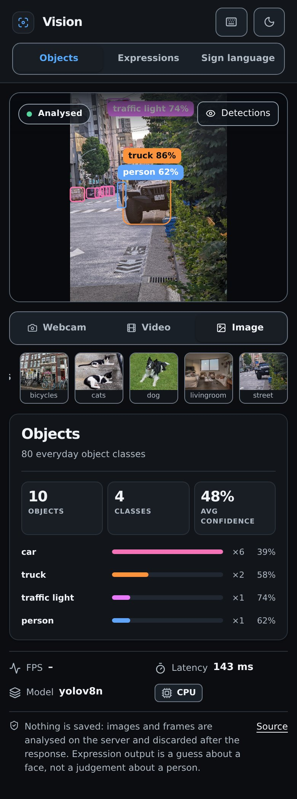

# AI Vision Detection

Object detection, facial-expression reading and ASL fingerspelling, live on your camera and **entirely in your browser**.
No server and no upload: the camera never leaves your device.

**Try it: https://dhiarekik.me/ai-vision-detection/**


| Sign language | On a phone |
| --- | --- |
|  |  |

Screenshots use Chromium's fake camera fed with the bundled sample photos.

## What it does

| Mode | What you see | Models |
| --- | --- | --- |
| **Objects** | Boxes and labels for 80 everyday object types, with a confidence filter | YOLO11n |
| **Expressions** | The expression on each face, scored across seven classes | YuNet + MobileFaceNet (OpenCV Zoo) |
| **Sign language** | ASL letters spelled into words, a practice challenge and seven hand gestures | MediaPipe hands + this project's letter classifier |

## Results

| | Result | How it was measured |
| --- | --- | --- |
| ASL letters | **47.3% → 76.0%** | 672 hands from a separate photo collection, not used for training ([details](docs/asl-eval.md)) |
| Objects | **18.5 fps** CPU (Python), mAP@0.5 0.626 | YOLO11n vs YOLOv8n on a 100-image COCO subset; same accuracy, faster |
| In the browser | **29 fps** objects on a 6-core CPU, 19 fps phone emulation | `scripts/web_bench.py`, no GPU ([details](docs/performance.md)) |
| Browser vs Python | **22 / 22** parity cases pass | Same labels, box IoU ≥ 0.90, scores within 0.05 |
| Expressions | **25%** on 700 photos (chance is 14%) | GFFD-2025; the weakest mode, so treat it as a rough guess |

The letter result misses the 80% target, and the test collection has no signer IDs, so it is not proven to be on
new people. J and Z need motion, which a single frame cannot show.

## How it works

Python trains and evaluates the models and exports them for the web; the browser runs them live. Tests check that both
give the same answers. Full picture with a diagram: **[docs/architecture.md](docs/architecture.md)**.

- **In the browser:** ONNX Runtime Web runs YOLO11n and the face models in Web Workers (WebGPU when available, else
  WASM). MediaPipe Tasks Vision finds hand landmarks, and a JavaScript port of the letter classifier reads them.
- **Downloads on demand:** a mode's model loads the first time you open it (5 to 20 MB) and is cached for later visits.
- **Static hosting:** the site is plain files on GitHub Pages ([DEPLOY.md](DEPLOY.md)).

## Built with

- **Models:** YOLO11n (objects), YuNet + MobileFaceNet from the OpenCV Zoo (expressions), MediaPipe hands plus this
  project's ASL letter classifier, a small MLP trained on open datasets.
- **Browser:** ONNX Runtime Web in Web Workers (WebGPU or WASM), plain HTML, CSS and JavaScript, hosted on GitHub Pages.
- **Python:** uv, PyTorch, Ultralytics, scikit-learn, OpenCV and FastAPI to train, evaluate and export the models and
  serve as the reference the browser is tested against.
- **Quality and tooling:** pytest and Playwright browser tests, ruff, mypy, GitHub Actions CI, with Claude as an AI
  coding assistant.

## Run it

```bash
uv sync
uv run python scripts/export_web_models.py --only vendor        # browser runtimes (not committed)
uv run python scripts/build_pages_artifact.py --out dist/site --serve 8013
# open http://127.0.0.1:8013/  (the camera works on localhost)
```

Tests: `uv run pytest -q` runs everything, including the Chromium parity and end-to-end suites
(`uv run playwright install chromium` and `ffmpeg` needed). Training and evaluation: [scripts/README.md](scripts/README.md).

## Project layout

| Path | What |
| --- | --- |
| `backend/static/` | The site: page, styles, JavaScript modules ([guide](backend/static/js/README.md)), models ([list](backend/static/models/README.md)) |
| `backend/app/` | Python reference inference, model registry and a FastAPI app for tests and local tools |
| `scripts/` | Training, evaluation, export, site build, benchmarks, screenshots |
| `tests/` | Unit tests, browser parity and end-to-end tests |
| `docs/` | [Architecture](docs/architecture.md), [performance](docs/performance.md), [ASL evaluation](docs/asl-eval.md), [datasets](docs/asl-datasets.md) |

## Licences

- Project code: MIT, see [LICENSE](LICENSE).
- YOLO11 (Ultralytics) is **AGPL-3.0**, so this repository and the site's source stay public.
- YuNet (MIT) and the expression model (Apache-2.0) come from the OpenCV Zoo. ONNX Runtime Web (MIT) and MediaPipe
  (Apache-2.0) are downloaded at build time.
- Full list with versions: [THIRD_PARTY.md](THIRD_PARTY.md). Hand drawings: public domain
  ([credits](backend/static/asl/README.md)).

## Responsible use

This is a portfolio project, not a sign-language interpreter or a tool for decisions about people. An expression label
is a guess about a face, not about how someone feels. Ask before pointing the camera at other people, and do not use it
for hiring, proctoring, policing or similar decisions.

Built by Dhia Rekik ([dhiarekik.me](https://dhiarekik.me), [@dhia-rek](https://github.com/dhia-rek)).
