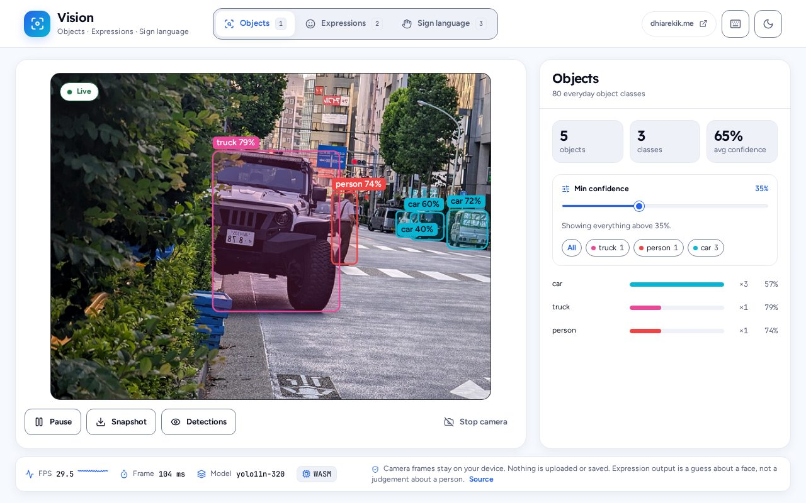
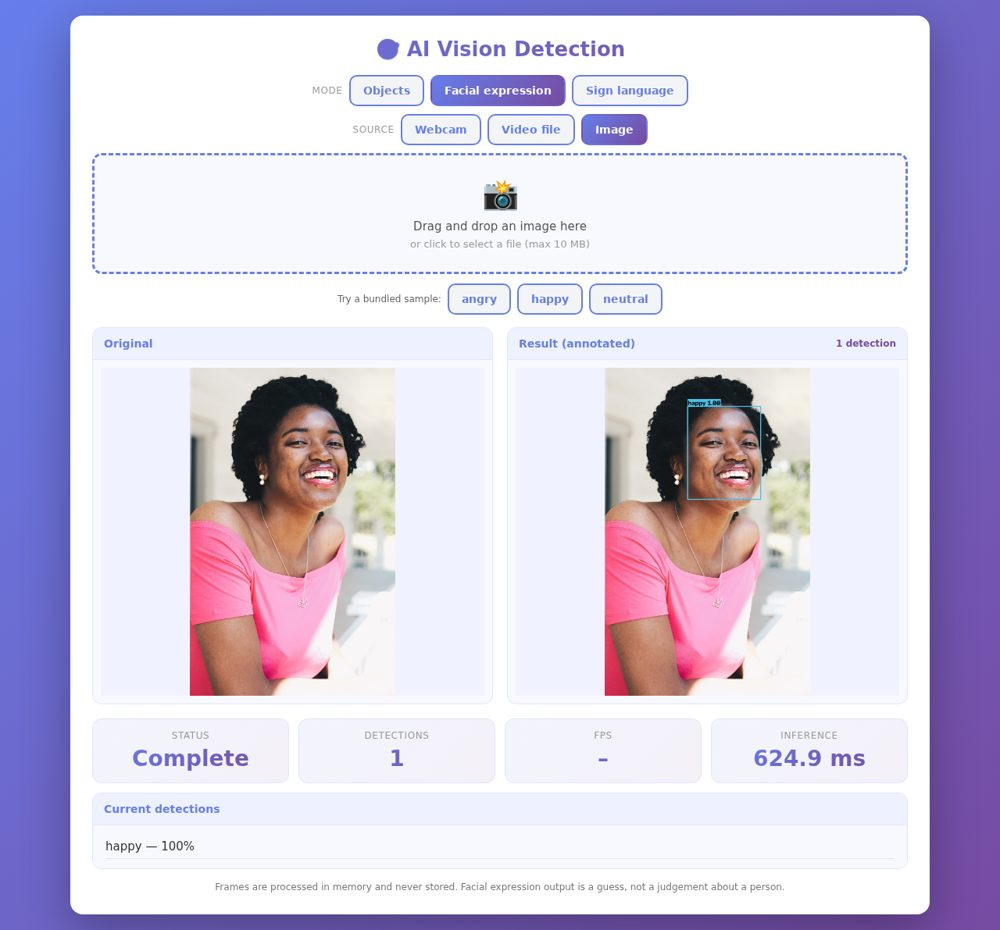
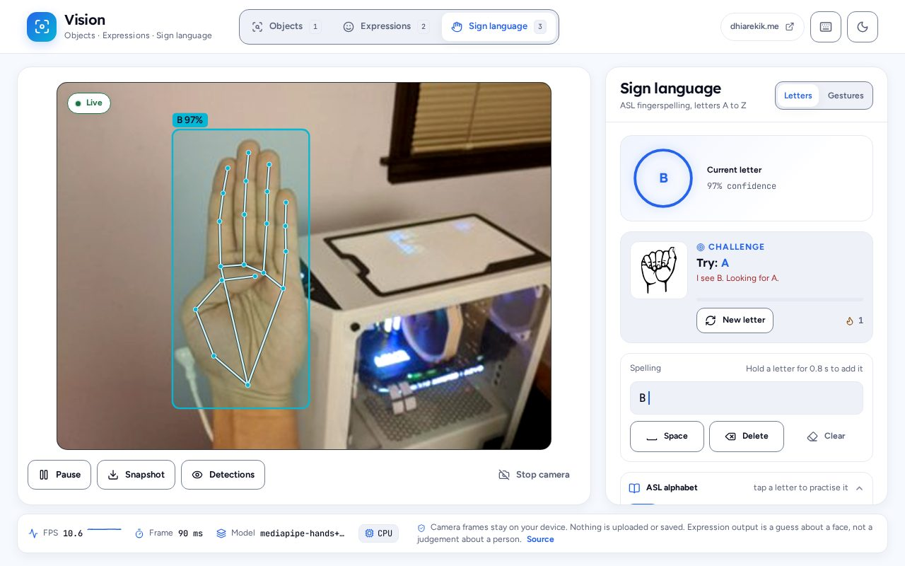

# AI Vision Detection

Live object detection, facial-expression classification, and ASL hand-shape recognition—processed locally in your browser. The static experience is designed for Dhia’s portfolio at **https://dhiarekik.me/vision**: no inference server, account, or camera-frame upload is required.


| Objects | Expressions | Sign language |
| --- | --- | --- |
|  |  |  |

All UI screenshots use Chromium’s fake **camera**, not an image/video upload feature. The app itself is live-camera-only.

## Static browser app

The browser app is served from a static origin. Python is **not** on the live inference path:

- Objects use YOLO11n ONNX Runtime Web (320 input on mobile, 640 otherwise), with preprocessing and NMS in JavaScript and inference in a Web Worker.
- Expressions use YuNet and MobileFaceNet ONNX with ONNX Runtime Web.
- Sign language uses MediaPipe Tasks Vision for hand landmarks/gestures and the exported ASL classifier JSON for letter inference.
- Models load lazily by selected mode. Browsers cache fetched assets; frames stay on-device.

The static distribution layout is `index.html` at its root with application assets under `static/`. Its relative asset URLs are intentional: the same artifact can be mounted at `/vision/` without changing its module or model paths. A workflow builds and uploads this artifact for inspection; it **does not deploy or publish** it. The portfolio deployment step is intentionally separate.

### Embed

Use a same-origin iframe and grant camera access. The parent page and app are both hosted on `dhiarekik.me`:

```html
<iframe src="/vision/?embed=1&mode=objects&theme=light"
        title="AI Vision Detection" allow="camera" loading="lazy"
        style="width:100%;height:560px;border:0;border-radius:16px"></iframe>
```

The `allow="camera"` attribute and HTTPS are required for browser camera access. `?embed=1` hides the app’s outer chrome. Other deep-link options include `mode=objects|faces|sign`, `sign_mode=spell|gestures`, and `theme=light|dark`.

### Model downloads, performance, and parity

Values are pending the Phase 2 headless-browser benchmark and parity run; do not treat the previous server-inference figures as browser performance.

| Mode / device | Model download size | Measured FPS | Sample parity |
| --- | ---: | ---: | --- |
| Objects — laptop (640) | TBD | TBD | TBD |
| Objects — recent phone (320) | TBD | TBD | TBD |
| Expressions — laptop / phone | TBD | TBD | TBD |
| Sign — laptop / phone | TBD | TBD | TBD |

Parity target for bundled sample images: identical labels, box IoU ≥ 0.90, and confidence delta ≤ 0.05 against the Python reference. Results will be filled in after the automated comparison completes.

## Python training and evaluation

The Python backend remains the source of training, reference inference, and evaluation tooling. It is not needed to host the static live app. Use Python for model training/evaluation and the API/test/demo workflows; export the ASL classifier with `scripts/export_web_models.py` when its weights change. The versioned JSON describes input features, normalization, classes, and arbitrary dense classifier layers so retrained weights can replace the JSON without changing browser inference code.

The API’s image/video endpoints remain available for tests, CLI tools, offline demos, and model evaluation. They are not called or exposed by the static UI. See [API and development](#api-and-development).

## Licenses

- Project code: MIT, see [LICENSE](LICENSE).
- ONNX Runtime Web: MIT. The pinned runtime and its WASM assets are vendored under `backend/static/vendor/ort/`; see [model and browser-asset notes](backend/static/models/README.md).
- MediaPipe Tasks Vision: Apache-2.0. The runtime is version-pinned; the gesture model is fetched lazily from Google’s model storage.
- YOLO11n: Ultralytics **AGPL-3.0**. The ONNX export and source remain public with this repository; serving/distributing the app has corresponding source-offer obligations. This project is not using an Ultralytics enterprise license.
- Face-model licenses, sources, checksums, and other asset attributions are recorded in [backend/static/models/README.md](backend/static/models/README.md). ASL illustration attribution is in [backend/static/asl/README.md](backend/static/asl/README.md); fonts use SIL OFL 1.1.

## API and development

Install and run the Python reference backend (Python 3.11+, `uv`):

```bash
uv sync
uv run pytest -q
uv run uvicorn app.main:app --app-dir backend --reload
```

For the static app, serve the repository root or the built artifact over HTTPS (or `localhost`) to enable camera access. Static app modules and inference details are documented in [backend/static/js/README.md](backend/static/js/README.md). The CI workflow runs Python lint, type checks, tests, and real-model smoke checks. The [Pages artifact workflow](.github/workflows/pages-artifact.yml) only builds and uploads the static artifact; it does not publish a site.

### Adding a mode

The UI keeps a clean fourth-mode extension point for the future Record panel. See [the JS module guide](backend/static/js/README.md); keep mode-specific inference separate and register the panel through the mode registry.

### API routes retained for tooling

`POST /api/analyze`, `POST /api/frame`, `POST /api/video`, `/demo/*`, and legacy detection routes are retained for Python tests, evaluation, and offline tooling. Their availability does not make them dependencies of the static app.

## Limitations and responsible use

This is a portfolio/demo project, not a replacement for an interpreter or a reliable system for consequential decisions. Expression labels are coarse visual classifications, not a statement about a person’s feelings. Sign mode recognizes a limited set of static hand shapes and gestures; it is not sign-language translation. Obtain consent before using the camera around other people. Do not use this demo for hiring, education/proctoring, policing, insurance, or other decisions about people.

Author: Dhia ([@dhia-rek](https://github.com/dhia-rek)).
