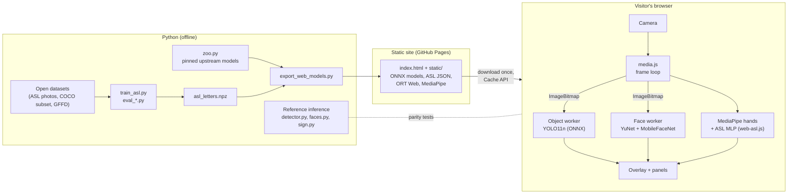

# Architecture

The project has two halves that share the same models:

- **Python** (`backend/`, `scripts/`) trains and evaluates the models, exports them for the web, and is the
  reference implementation the browser is tested against.
- **The browser** (`backend/static/`) is the product: it opens the camera and runs every model on the device.
  Nothing is sent to a server, so the site is plain static files on GitHub Pages.

## The three modes

| Mode | Models | Where it runs | Notes |
| --- | --- | --- | --- |
| Objects | YOLO11n, exported to ONNX with dynamic input size | Web Worker pool, WebGPU when available, else WASM | 320 px input on phones and CPU-only devices, 640 px with WebGPU |
| Expressions | YuNet face detector + MobileFaceNet expression classifier (OpenCV Zoo) | Web Worker | Seven classes; the weakest mode (25% on GFFD-2025, chance is 14%) |
| Sign language | MediaPipe hand landmarks + gestures, and this project's ASL letter classifier | Main thread (MediaPipe), classifier in plain JS | 287 hand features, small MLP, letter smoothing over frames |

## Frame flow

1. `media.js` grabs a frame from the camera and turns it into an `ImageBitmap`.
2. `web-inference.js` hands it to the active engine. Object and face engines live in Web Workers, so the page only
   draws. On CPU-only devices several workers keep a few frames in flight; results that arrive out of order are dropped.
3. The engine returns the same detection payload the Python API returns (`class`, `confidence`, `bbox`, and extra
   fields per mode).
4. `overlay.js` draws boxes, landmarks and labels; `insights.js` and `sign.js` update the side panel.

Only the active mode's model is loaded. A model downloads the first time its mode opens, with a progress bar, and is
then kept in the browser's Cache API so later visits start offline.

## Keeping the two halves honest

The browser re-implements pre- and post-processing (letterboxing, NMS, YuNet decoding, ASL features), so drift is the
main risk. Three test suites guard it:

- `tests/test_web_parity.py` runs the browser pipeline in Chromium on the sample images and compares it with Python:
  same labels, box IoU of at least 0.90, scores within 0.05 (22 cases).
- `tests/test_web_asl_parity.py` checks the JS ASL features and classifier against NumPy (features to 2e-5,
  probabilities to 1e-4).
- `tests/test_web_e2e.py` drives the real page with a fake camera on desktop and phone layouts.

The ASL weights file carries its feature version; the browser refuses weights built for different features instead of
silently giving wrong letters.

## Training the letter model

`scripts/train_asl.py` extracts MediaPipe hand landmarks from open ASL photo collections, builds the 287 features in
`backend/app/sign_features.py`, and trains a small MLP. Evaluation uses a separate photo collection that was not used
for training: accuracy went from 47.3% to 76.0%. Details, per-letter results and caveats: [asl-eval.md](asl-eval.md);
datasets and licences: [asl-datasets.md](asl-datasets.md).

## Where things live

| Path | What |
| --- | --- |
| `backend/static/` | The site: `index.html`, CSS, JS modules, models, preview clips |
| `backend/static/js/` | Browser modules, one job each ([module guide](../backend/static/js/README.md)) |
| `backend/static/models/` | Web models with sizes and checksums ([list](../backend/static/models/README.md)) |
| `backend/app/` | Python reference inference, model registry (`zoo.py`), FastAPI app for tests and local tools |
| `scripts/` | Training, evaluation, export, site build, benchmarks, screenshots and preview clips ([guide](../scripts/README.md)) |
| `tests/` | Python unit tests, browser parity and end-to-end tests |
| `.github/workflows/` | CI (lint, types, tests) and the Pages deploy |
